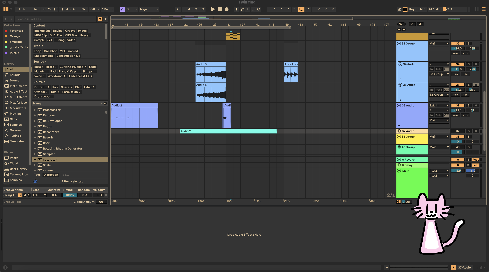
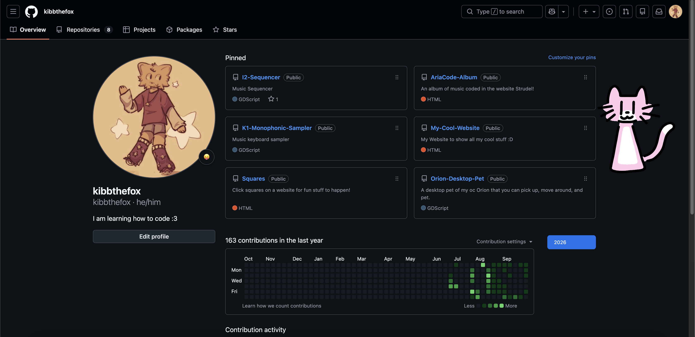

# **Orion Desktop Pet**

## General Information
This project is a desktop pet of my OC Orion that was made with GDScript (Godot) for the two [Hackclub](https://hackclub.com/) programs [Stardance](https://stardance.hackclub.com/home) and [Playground](https://playground.hackclub.com/). (To be exact I did the playground mission on stardance)

Orion is 15 year old cat. She is very sweet, but is often stressed out by something. She likes thunder, winter, and tea, and thinks that white isn't a color.

## Usage

Orion stays on top of your desktop and can be grabbed at the body and moved around. Also give them many headpats :3

## Opening Instructions

### Versions Tested
MacOS has been tested multiple times. Windows has been tested once.
| OS      | Version        | Processor                                     |
| ------- | -------------- | --------------------------------------------- |
| MacOS   | Ventura 13.7.8 | 2.9 GHz Quad-Core Intel Core i7.              |
| Windows | Windows 11     | 13th Gen Intel(R) Core(TM) i5-1345U (1.60 GHz)|

Other versions of Windows/MacOS may potentially work.

### MacOS
To open, uncompress the zip, and right click on the file. Select "Open" and then it will open up a window. Click "Open" again and then the program will open. You will probably need to do this twice because gatekeeper usually blocks it the first time.

### Windows
Uncompress the .zip and open the file. If a windows security window shows up, click "more info" and then click "Run Anyway"

## Screenshots

    
    
Orion watching me make music :3

    
    
Orion looking at my github :D

## AI Disclosure
AI was only used for help with css properties on the screenshots on this README. It was not used for the desktop pet at all.
